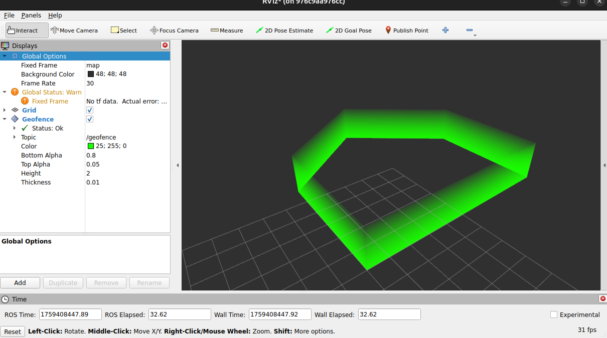
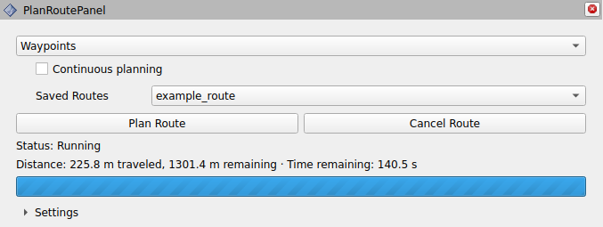

# `rviz_plugins`

Custom RViz plugins for OpenADS

| Plugin | Description | Screenshot |
| --- | --- | --- |
| **Geofence Display** | Visualizes `geometry_msgs/msg/PolygonStamped` messages as geofences in RViz. |  |
| **Plan Route Panel** | Configures and monitors the [`plan_route_action_client`](https://github.com/openads-project/lanelet2_route_planning) of the Lanelet2 route planning. |  |

## Plan Route Panel

RViz panel for configuring and monitoring the existing `plan_route_action_client`. It does not start that node or send `PlanRoute` action goals itself. The client and the Lanelet2 route planning server must already be running.

In RViz, select **Panels → Add New Panel → rviz_plugins/PlanRoute**. The default client node is `/plan_route_action_client`. Configure the routes file and endpoint names in the collapsed **Settings** section at the bottom of the panel if your setup uses different names. RViz saves these fields in its configuration.

### Planning modes

Select one mode from the dropdown:

| Mode | Primary button | Behavior |
| --- | --- | --- |
| **Waypoints** | **Plan Route** | Sends the selected saved route to the client's `waypoints` parameter. **Continuous planning** loops/replans the route; **Replan after fraction** sets `continuous_planning_replanning_proportion` (0–1). |
| **Random Destination** | **Plan Route** | Enables the client's random destination mode, disables continuous planning, and clears its waypoints. |
| **Destination (Click)** | **Set Destination** | Selects RViz's built-in Goal Pose tool. Click a destination in the RViz view; the tool publishes a `PoseStamped` to the configured goal pose topic and the client handles it. |

**Cancel Route** disables automatic planning, clears the client's waypoints, and requests cancellation of active goals. The client uses `async_cancel_all_goals`, which can also affect goals from other clients connected to the same action server. The panel's status is based on the configured action's status, feedback, and result endpoints. It reports route progress when feedback arrives. The progress bar appears for pending or running Waypoints and Random Destination goals; Destination (Click) uses status text only. Rejected goals may not appear in action status.

**Destination (Click)** does not change the client's random destination, continuous planning, or waypoint parameters. If those modes are still active, the client can subsequently issue another goal. Clear the previous mode before using a clicked destination.

### Saved routes

Saved routes are read from the file configured as **Routes File** in the panel settings, which defaults to the installed [`share/rviz_plugins/config/plan_route/routes.yml`](config/plan_route/routes.yml). Each route is an ordered list of the same WGS84 waypoint strings accepted by the client's `waypoints` parameter:

```yaml
routes:
  example_route:
    - "50.787524, 6.050095, -1"
    - "50.779794, 6.050634, -1"
    - "50.784935, 6.043669, -1"
    - "50.787801, 6.046555"
```

The format is `latitude, longitude[, wait_time_s]`. A negative wait time marks an intermediate waypoint; the final waypoint must have a nonnegative wait time or omit it. The panel also accepts the older `{latitude, longitude, wait_time_s}` mapping format. Route names are loaded when the panel is created or the **Routes File** setting is changed. Route contents are read again when **Plan Route** is pressed.

### Settings and ROS connections

| Setting | Purpose |
| --- | --- |
| **Routes File** | YAML file containing the saved routes. |
| **LL2 Map Server Name** | Display/configuration field only. The client reads `ll2_map_server_name` at startup; editing this field does not reconfigure it. |
| **Action Client Node** | Node whose `get_parameters` and `set_parameters_atomically` services the panel uses. |
| **Goal Pose Topic** | Topic assigned to RViz's Goal Pose tool in click mode; the client must subscribe to the same topic. |
| **Status Action** | Base name of the `PlanRoute` action. The panel derives `/_action/status`, `/_action/feedback`, and `/_action/get_result` from it. |

The panel reads client parameters when RViz initializes, when the client parameter service becomes available, or when the client node name changes. It does not continually poll parameter values. The action server's goal IDs do not identify the client that sent each goal, so goals from another client on the same action can appear as the panel's current goal.

The panel depends on the parameter interface of `plan_route_action_client` (`waypoints`, `enable_random_destination`, `enable_continuous_planning`, `continuous_planning_replanning_proportion`, `cancel_route`). Changes to these parameters in [`lanelet2_route_planning`](https://github.com/openads-project/lanelet2_route_planning) require a corresponding update of this panel.
